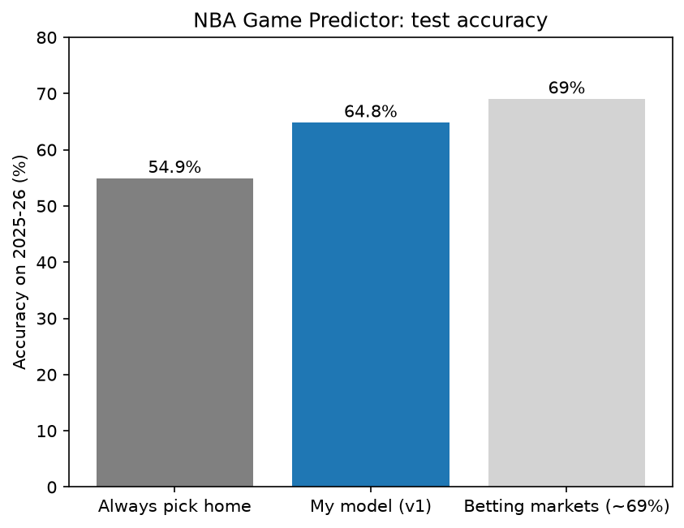

# NBA Game Predictor

**Predicting NBA game winners from pre-game team form, built to be tested on the live 2026-27 season.**


A logistic regression model trained on four NBA seasons predicts the winner of an unseen season **64.8%** of the time, almost 10 points better than always picking the home team. Every feature uses only information available before tip-off.

---

## Table of Contents
- [Results](#results)
- [How It Works](#how-it-works)
- [Avoiding Data Leakage](#avoiding-data-leakage)
- [Project Structure](#project-structure)
- [Getting Started](#getting-started)
- [Limitations](#limitations)
- [Acknowledgements](#acknowledgements)

---

## Results

Tested on the full **2025-26 regular season** (1,071 games), which the model never saw during training.

| Model | Test accuracy |
|---|---|
| Baseline: always pick the home team | 54.9% |
| **Logistic regression (v1)** | **64.8%** (95% CI ≈ ±2.9%) |
| Betting markets (reference) | ~68–70% |



**Key takeaways**
- Even the low end of the confidence interval (~61.9%) clearly beats the baseline, so the gain isn't luck.
- The model learned a positive intercept on its own, which is home-court advantage.
- The full gap from baseline to Vegas is only ~14 points; v1 closes about two-thirds of it with 12 simple features.

---

## How It Works

```
nba_api  →  12,300 team-game rows  →  pre-game features  →  one row per game  →  train / test by season  →  logistic regression
```

**1. Data:** every regular-season game from 2021-22 to 2025-26, pulled with [`nba_api`](https://github.com/swar/nba_api). Preseason, playoffs, All-Star and Cup final games are removed.

**2. Features:** possessions and ratings are derived from box scores, then averaged over each team's **previous 10 games**:

| Feature | Description |
|---|---|
| `ORTG_L10` | Offensive rating: points scored per 100 possessions |
| `DRTG_L10` | Defensive rating: points allowed per 100 possessions |
| `NET_L10` | Net rating: `ORTG_L10 − DRTG_L10` |
| `REB_L10` | Rebounds per game |
| `WIN_L10` | Win percentage |
| `REST_DAYS` | Days since the team's last game (1 = back-to-back) |

Possessions are estimated as `FGA + 0.44·FTA − OREB + TOV`. Ratings adjust for pace, so a slow team isn't mistaken for a good defence.

**3. Matchups:** home and away rows are merged on `GAME_ID`, so each game has both teams' features side by side (6 × 2 = **12 inputs**). Ten international neutral-site games have no home team and are excluded.

**4. Model:** scikit-learn `LogisticRegression`, trained on 2021-22 to 2024-25 (4,291 games) and tested on 2025-26 (1,071 games).

---

## Avoiding Data Leakage

A model that sees the answer in its inputs looks great and is useless. This project guards against that in three ways:

- **No same-game stats.** Rolling averages are built from `shift(1)`, so a game only sees the team's earlier games, never its own box score.
- **Season resets.** Rolling windows are grouped by team *and* season, so October doesn't average in last April.
- **Time-based split.** Train on earlier seasons, test on a later one. A random split would let the model learn from March to "predict" January.

A sorting bug caught during development (rows ordered newest-first made `shift` pull the *next* game) is documented in the features notebook.

---

## Project Structure

```
nba-game-predictor/
├── notebooks/
│   ├── 01_pull_data.ipynb      # explore one season from the API
│   ├── 02_pull_seasons.ipynb   # pull 5 seasons, keep regular season
│   ├── 03_baseline.ipynb       # home-team baseline, neutral-site games
│   ├── 04_features.ipynb       # ratings and 10-game rolling features
│   └── 05_model.ipynb          # matchups, split, train, evaluate
├── data/                       # generated CSVs (gitignored)
├── requirements.txt
└── README.md
```

---

## Getting Started

**Prerequisites:** Python 3.13+

```bash
git clone https://github.com/sebnalli/nba-game-predictor.git
cd nba-game-predictor
python -m venv venv
source venv/bin/activate        # Windows: venv\Scripts\activate
pip install -r requirements.txt
```

**Reproduce the results.** Data isn't stored in the repo, so run the notebooks in order:

1. `02_pull_seasons.ipynb` → `data/games_2021_26.csv` (about a minute of API calls)
2. `04_features.ipynb` → `data/features.csv`
3. `05_model.ipynb` → trains the model and prints test accuracy

---

## Limitations

- **Early-season games are skipped.** A team needs 10 games of history, so roughly the first three weeks of each season (~12% of games) aren't predicted.
- **Team-level only.** No player data, so injuries and trades only show up once they affect results.
- **Unscaled features.** Model weights aren't directly comparable yet.

---

## Acknowledgements

- [`nba_api`](https://github.com/swar/nba_api) for access to NBA Stats data
- Possession and rating formulas follow standard basketball analytics conventions (Dean Oliver, *Basketball on Paper*)

---

**Sebastian Nalli** · [GitHub](https://github.com/sebnalli)